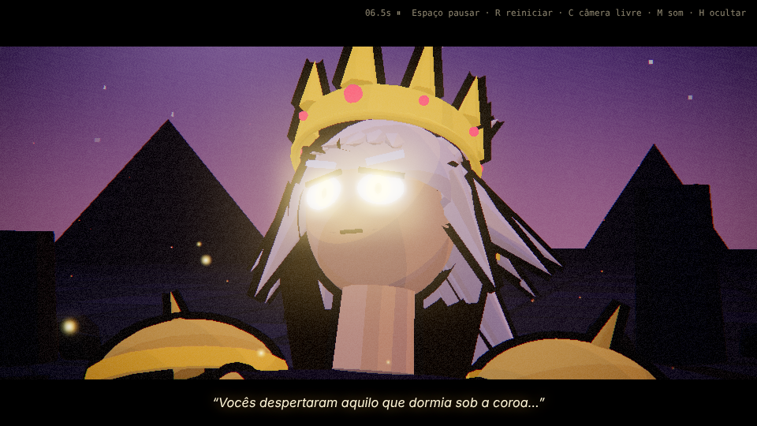
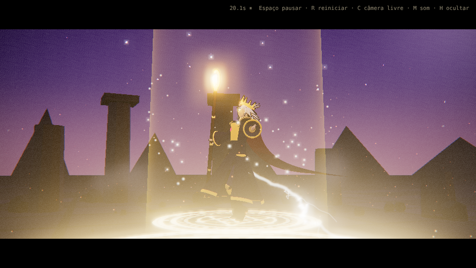
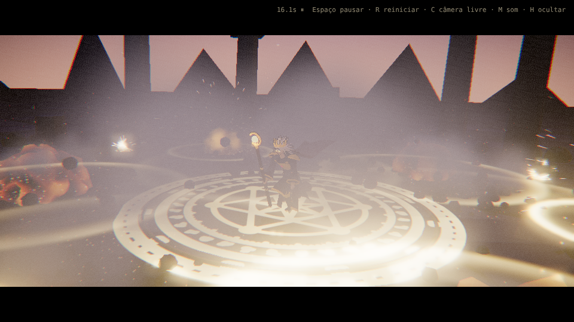
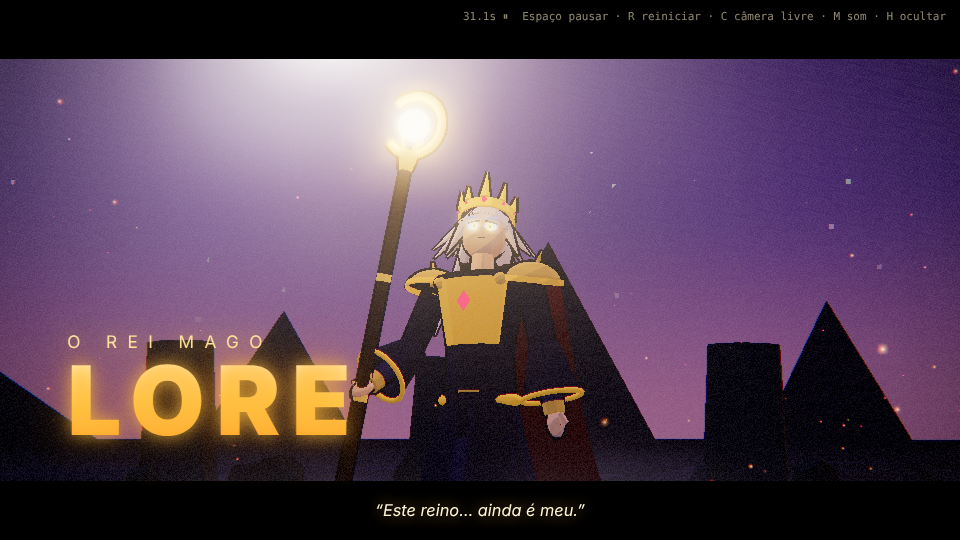

# LORE — O Rei Mago · Cutscene em WebGL

Cutscene cinematográfica de anime (≈34 s, em loop) protagonizada por **Lore, o Rei Mago**,
renderizada em tempo real no navegador com **Three.js (WebGL)**.

Lore em corpo inteiro, com rig articulado, poses mescladas, capa/cabelo/manto com movimento
secundário, câmera cinematográfica com cortes e tremores sincronizados aos impactos, e efeitos
mágicos dourados: explosões, raios, partículas, ondas de choque, fumaça, destroços, clarões,
círculo rúnico, pilar de luz e feixe de energia. Som 100% procedural (Web Audio).

## Como executar

Os módulos JavaScript **não funcionam abrindo o arquivo direto** (`file://`). Use um servidor local
na pasta do projeto:

```bash
# opção 1 — Python (já vem no macOS/Linux)
python3 -m http.server 8000

# opção 2 — Node.js
npx serve .
```

Abra **http://localhost:8000** e clique em **▶ Iniciar** (o clique libera o áudio do navegador).

O Three.js r160 já está incluído em `vendor/three/`: **não precisa de internet nem de `npm install`**.

### Controles

| Tecla | Ação |
|---|---|
| `Espaço` | pausar / continuar |
| `R` | reiniciar |
| `← / →` | voltar / avançar 5 s |
| `C` | câmera livre (arrastar para orbitar, rolar para zoom) |
| `M` | ligar/desligar o som |
| `H` | ocultar HUD · `L` alternar barras de cinema |

### Parâmetros de URL

- `?autoplay` — começa sem a tela inicial
- `?t=14` — começa no segundo 14 (ex.: direto na explosão)
- `?nosound` — sem áudio

## Estrutura

```
index.html              Página, import map (Three.js local), overlays
css/style.css           Letterbox, título, legendas, clarão, tela inicial
js/
  main.js               Renderer, pós-processamento, loop, controles
  config.js             ★ Cores, proporções, bloom, qualidade, duração
  character.js          ★ Lore: rig, materiais toon + contorno, capa, cajado
  poses.js              ★ Biblioteca de poses (rotações por articulação)
  cutscene.js           ★ Roteiro: planos de câmera + eventos sincronizados
  camera.js             Diretor de câmera (interpolação, órbita, tremor)
  timeline.js           Eventos, intervalos e tweens
  environment.js        Arena em ruínas, céu com lua/estrelas, luzes
  audio.js              Sons procedurais (explosão, trovão, carga, feixe)
  utils.js              Easing, ruído GLSL, texturas geradas
  effects/
    index.js            Receitas: explode(), strike(), arcs(), converge()…
    particles.js        Partículas brilhantes, faíscas, fumaça, destroços
    lightning.js        Raios fractais com ramificações
    explosion.js        Bola de energia (shader de ruído), anel e casca de choque
    magicCircle.js      Círculo rúnico e pilar de luz
    beam.js             Feixe de energia
vendor/three/           Three.js r160 (MIT) + addons usados
```

## Como aprimorar

- **Aparência de Lore** → `js/config.js` (`character`): cores de cabelo, olhos, manto, capa,
  coroa, cajado, espessura do contorno. A geometria está em `character.js` (`_build`), dividida
  por partes (quadril, pernas, tronco, braços, cabeça, cabelo, coroa, capa, cajado).
- **Movimentos** → `js/poses.js`: cada pose é uma lista de rotações. Teste ao vivo no console:
  `LORE.lore.setPose('raise', 0.6)`. Para criar uma pose nova, adicione-a em `POSES` e use-a em
  `cutscene.js`.
- **Roteiro, câmera e sincronização** → `js/cutscene.js`: `director.setShots([...])` define os
  planos; `tl.at(t, fn)` dispara eventos; `tl.during(t0, t1, fn)` roda efeitos contínuos.
- **Efeitos** → `fx.explode(pos, potência)`, `fx.strike(pos)`, `fx.arcs(pos)`, `fx.converge(pos)`
  em `js/effects/index.js`. Paleta da magia em `CONFIG.magic`.
- **Desempenho** → reduza `CONFIG.quality.maxParticles`, `pixelRatioCap` ou desative `shadows`.
- **Modelo 3D próprio** → para trocar o personagem procedural por um `.glb` (ex.: feito no
  Blender/VRoid), carregue-o com `GLTFLoader` e mapeie os ossos para os nomes de `poses.js`.

## Prévia

| | |
|---|---|
|  |  |
|  |  |

*(Capturas geradas por renderização de software em um teste automatizado; numa GPU real a imagem é mais nítida e roda em tempo real.)*

---

## SOLEVA — loja de sneakers

Este repositório também contém **SOLEVA**, um e-commerce de tênis em React + TypeScript.
Veja [`soleva/README.md`](soleva/README.md).
